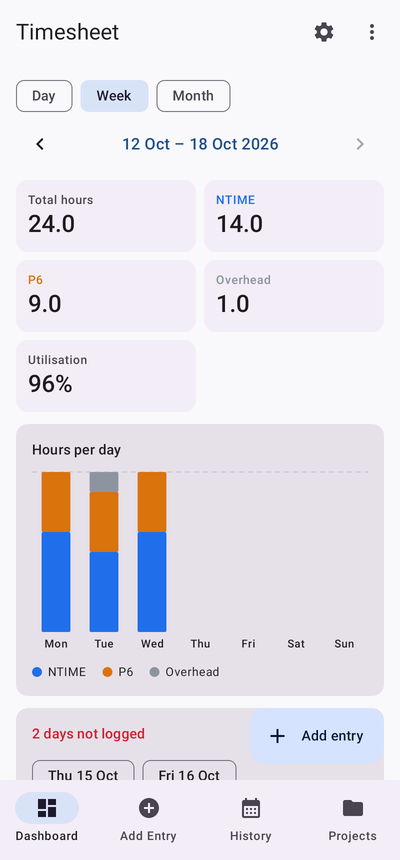
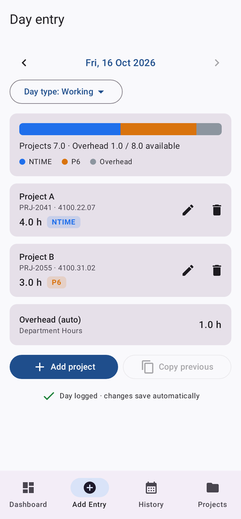
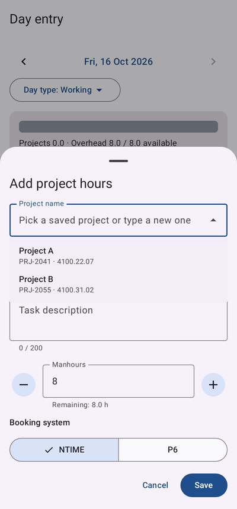
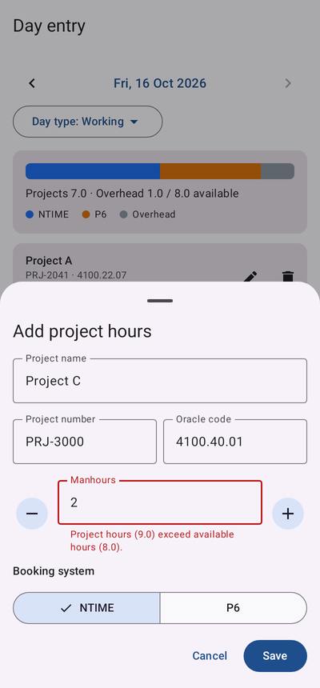
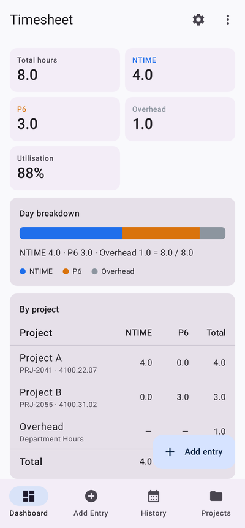
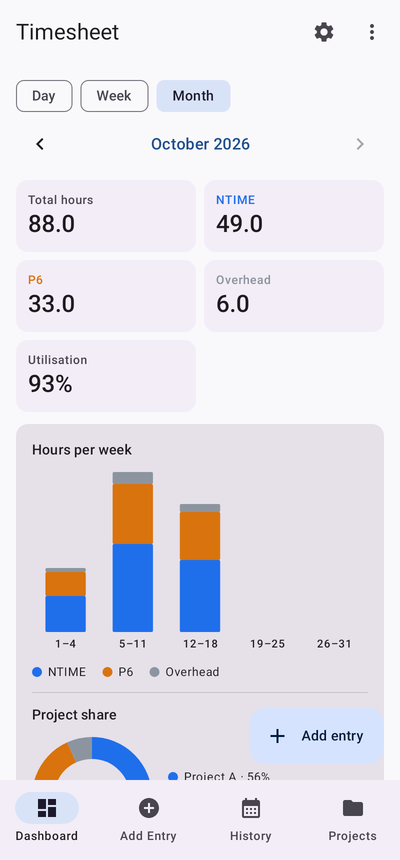
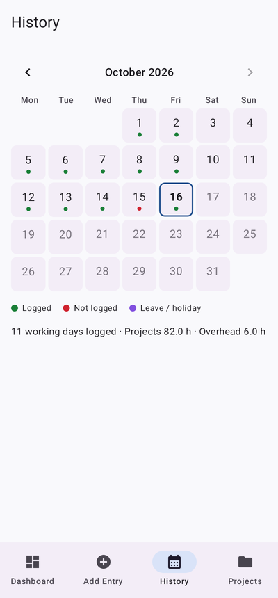
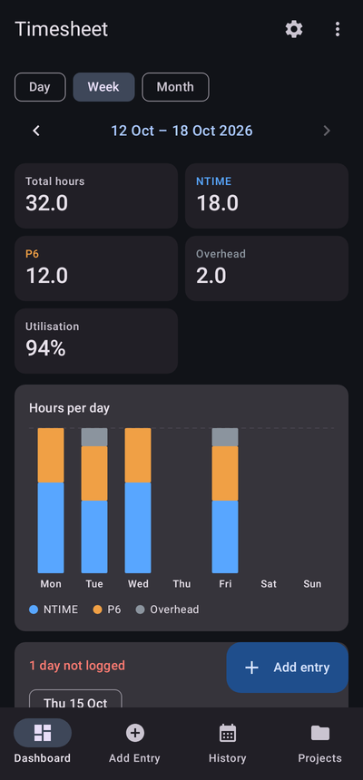

# Timesheet

Android app for logging daily project manhours against **NTIME** and **P6**. Hours not booked to a project are automatically assigned to **Overhead** (Department Hours), and a dashboard shows daily, weekly and monthly totals.

- Specification: [docs/SPEC.md](docs/SPEC.md)

| Dashboard (week) | Day entry | Saved-project dropdown | Over-allocation blocked |
|---|---|---|---|
|  |  |  |  |

| Day totals by project | Month | History | Dark theme |
|---|---|---|---|
|  |  |  |  |

*(Screenshots are generated by `AppFlowTest`, which drives the real app under Robolectric.)*

## Features

- **Day entry** (FR-1): Project name, project number, Oracle code, task description, manhours, and NTIME or P6 for each line. Saved projects can be picked from a dropdown on the Project name field, which fills in the number, Oracle code and last-used system; a new project can still be typed in. One project can have hours in both systems on the same day. Includes Copy previous day and a day type (Working, Leave, Public Holiday, Weekend).
- **Overhead** (FR-2): `overhead = available hours − project hours` (8 h by default), only on working days. A day can't be saved if its project hours exceed the available hours, unless *Allow overtime* is on. Example: Project A 4 h NTIME + Project B 3 h P6 → 1 h overhead.
- **Dashboard** (FR-3): Day / Week / Month views with totals for NTIME, P6, overhead and utilisation. Shows stacked charts, a per-project table, a project-share donut (month), and working days not yet logged. Updates as soon as an entry changes.
- **Projects** (FR-4): saved automatically on first use. Search, add, edit, archive. Projects with logged hours can't be deleted. Each project has a lifetime total and a last-12-weeks chart.
- **History and export** (FR-5): calendar with logged / not logged / leave markers. Export the shown period to CSV or PDF via the share sheet, or copy a plain-text summary grouped by system.
- **Settings** (FR-6): available hours, hours step, week start, weekend days, overtime, which system overhead is booked into, future dates, theme, and JSON backup/restore. Changing available hours applies to new days only, with an option to apply it to saved days from a chosen date.
- **Reminder** (FR-7): optional daily notification on working days that haven't been logged.

## Excel version

[`excel/Timesheet_2026.xlsx`](excel/Timesheet_2026.xlsx) does the same job in a workbook, with no app needed:

- **One sheet per month.** On the left is an entry log: date, project (dropdown), task description, NTIME/P6 and hours; the project number and Oracle code fill in automatically, and a Check column flags problems. On the right is a dashboard with the month's totals, a weekly summary and chart, projects this month (largest first), and a daily summary showing each day's overhead and status.
- **2026 Dashboard:** year totals, a month-by-month table and chart, and the top projects.
- **Projects** (enter each once) and **Settings** (available hours, week start, where overhead is booked, overtime).

The overhead rules are the same as the app's. Rebuild it for another year with `python3 excel/build_timesheet_xlsx.py 2027 excel/Timesheet_2027.xlsx`.

## Build and run

Requirements: JDK 17+ and the Android SDK (platform 35). Either open the project in Android Studio, or:

```sh
./gradlew assembleDebug        # APK at app/build/outputs/apk/debug/app-debug.apk
./gradlew installDebug         # install on a connected device or emulator
./gradlew testDebugUnitTest    # all tests (JVM + Robolectric)
```

Minimum Android version: 8.0 (API 26).

## Tests

| Suite | Covers |
|---|---|
| `TimesheetCalculatorTest` | Overhead, overtime, period roll-ups, week/month boundaries, chart buckets; acceptance criteria 1–6 and 8–10 |
| `HoursAndExportTest` | Hours parsing, rounding and formatting; CSV escaping and totals (AC 11); clipboard summary |
| `RepositoryTest` | Room DAOs: unique project key, delete restriction, merge/edit, available-hours snapshot, copy day, backup round trip, database migration v1 → v2 |
| `EntryViewModelTest` | Entry rules end to end: validation, rename and merge prompts, rounding, live overhead update (AC 7) |
| `AppFlowTest` | Drives the full UI (navigation, entry sheet, dashboard, history, projects, settings, dark mode) and writes screenshots to `app/build/screenshots` |

## Project layout

```
app/src/main/java/com/ikhanai/timesheet/
 ├─ domain/     Pure Kotlin: TimesheetCalculator, Periods, Hours, ExportFormat
 ├─ data/       Room entities/DAOs, TimesheetRepository, SettingsRepository (DataStore), backup JSON
 ├─ ui/         Compose screens: dashboard/, entry/, history/, projects/, settings/, components/, theme/
 ├─ reminder/   WorkManager daily reminder
 └─ MainActivity, TimesheetApp (manual DI container)
```

## Differences from the spec

- **Dependency injection:** a small manual container (`AppContainer`) instead of Hilt. The app has few dependencies, so this avoids extra build tooling.
- **Charts:** drawn with Compose `Canvas` instead of the Vico library.
- **Archiving projects:** done with an archive button on the project screen rather than swipe-to-archive.
- **Export range:** exports cover the period shown on the dashboard (day, week or month); custom date ranges aren't supported yet.
- **Strings:** UI text is in English and not yet moved into `strings.xml`. Layouts use start/end alignment, so right-to-left languages should work once translations exist.
